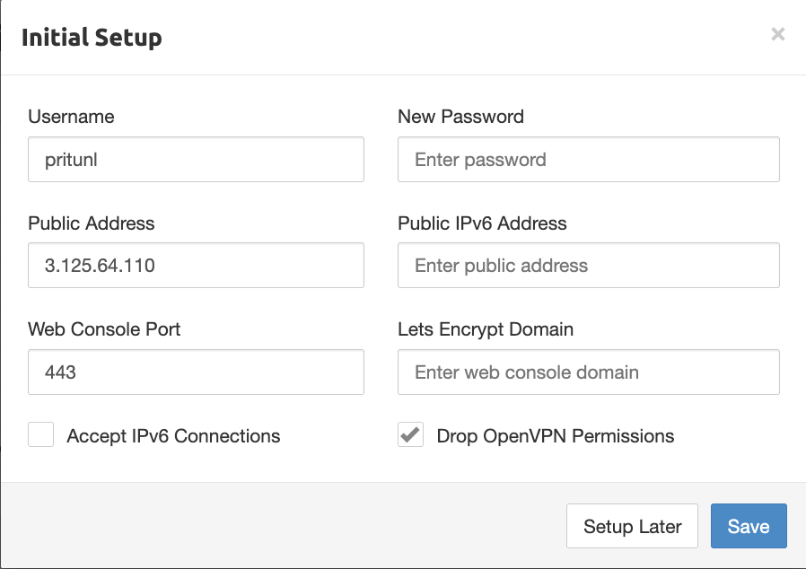
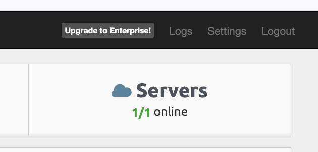

# Розгортання Pritunl Enterprise в AWS - розгортання через Terraform

Цей документ описує розгортання **self-hosted Pritunl Enterprise в AWS** із використанням Terraform. Основний підхід — **hybrid bootstrap**: Terraform створює AWS-ресурси та встановлює Pritunl і MongoDB, а початкове налаштування Pritunl, активація ліцензії та створення API credentials виконуються вручну. Після цього Terraform Provider керує підтримуваними параметрами VPN.

## 1. Prerequisites

Для розгортання потрібні:

- **AWS account** із правами на EC2, VPC, IAM, Elastic IP та Systems Manager.
- **AWS CLI v2** і налаштований aws profile.
- **Terraform** - версія та обмеження провайдерів визначені у [`network/providers.tf`](../network/providers.tf), [`compute/providers.tf`](../compute/providers.tf) і [`pritunl/provider.tf`](provider.tf).
- **AWS Session Manager plugin** — для доступу до Pritunl Web UI через SSM-тунель без відкриття адміністративного порту в інтернет.
- **[Pritunl Client](https://client.pritunl.com/#install)** — для перевірки підключення після налаштування.
- **[Pritunl Enterprise Pricing](https://pritunl.com/#pricing)** — актуальні тарифи та вартість ліцензій Pritunl.

## 2. AWS-ресурси для Pritunl

Для базового self-hosted deployment потрібні VPC/subnet, security group, EC2 для Pritunl, IAM instance profile та стабільна адреса підключення (Elastic IP або інший відповідний endpoint). У поточному варіанті MongoDB розміщена на тому самому EC2.

Ресурси описані у двох Terraform roots:

| Компонент | Де шукати конфігурацію |
| --- | --- |
| VPC, subnet, маршрути | [`network/`](../network/) |
| Security Groups | [`network/security-groups.tf`](../network/security-groups.tf) |
| Pritunl EC2 та user-data | [`compute/pritunel.tf`](../compute/pritunel.tf) |
| Встановлення MongoDB і Pritunl | [`compute/templates/pritunl.sh.tftpl`](../compute/templates/pritunl.sh.tftpl) |
| Elastic IP | [`compute/elastic-ip.tf`](../compute/elastic-ip.tf) |
| IAM і SSM | [`compute/iam.tf`](../compute/iam.tf) |
| Outputs | [`compute/output.tf`](../compute/output.tf) |

## 3. Початкове налаштування Pritunl

Після встановлення пакетів потрібно завершити початкового налаштування Pritunl: підключення до MongoDB, створення/налаштування адміністратора, активацію Enterprise-ліцензії та генерацію API credentials. 

Підключаємося до EC2 через AWS SSM Session Manager:

```bash
aws ssm start-session \
  --target <PRITUNL_INSTANCE_ID> \
  --profile awslab \
  --region eu-central-1
```

  Отримуємо ключ початкової ініціалізації Pritunl:

```bash
sudo pritunl setup-key
```

В окремому терміналі налаштовуємо Port Forwarding для доступу до Web UI:

```bash
aws ssm start-session \
  --target <PRITUNL_INSTANCE_ID> \
  --document-name AWS-StartPortForwardingSession \
  --parameters '{"portNumber":["443"],"localPortNumber":["8443"]}' \
  --profile awslab \
  --region eu-central-1
```

Відкриваємо https://localhost:8443, вводимо Setup Key та завершуємо ініціалізацію MongoDB (mongodb://localhost:27017/pritunl).

Після ініціалізації отримуємо облікові дані адміністратора:

```bas
sudo pritunl default-password
```

Після авторизації відкриється вікно **Initial Setup**. Задаємо пароль адміністратора, вказуємо Public Address (Elastic IP) VPN-сервера та зберігаємо налаштування.

<p align="center">
  
</p>

<p align="center">
  <em>Початкове налаштування Pritunl</em>
</p>

Активація Enterprise-ліцензії

Для подальшого керування Pritunl через Terraform необхідний API-доступ, який доступний у Enterprise-версії.

Після початкового налаштування відкриваємо розділ Subscription, активуємо ліцензію та переходимо до створення API Token і API Secret у розділі Administrators.

Актуальні тарифи та придбання ліцензії: Pritunl Pricing(https://pritunl.com/#pricing).

У Web UI натискаємо **Upgrade to Enterprise!** та активуємо ліцензію.

<p align="center">
  
</p>

<p align="center">
  <em>Активація Pritunl Enterprise</em>
</p>