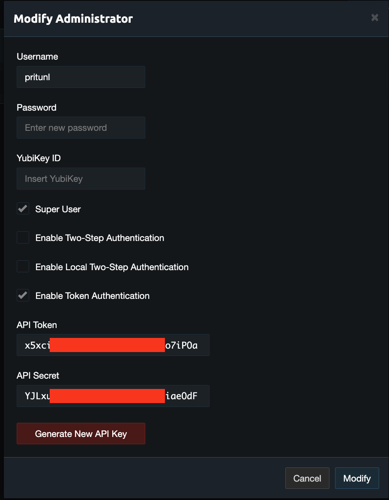
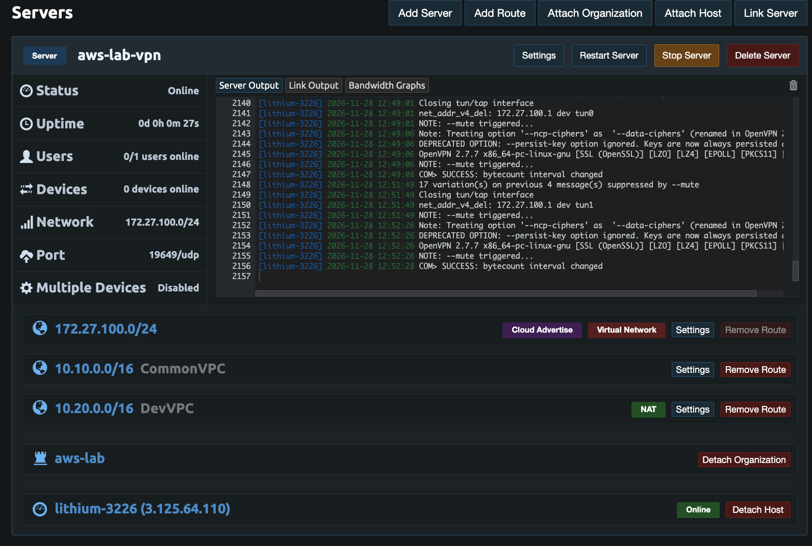

# Розгортання Pritunl Enterprise в AWS - розгортання через Terraform

Цей документ описує розгортання **self-hosted Pritunl Enterprise в AWS** із використанням Terraform. Основний підхід — **hybrid bootstrap**: Terraform створює AWS-ресурси та встановлює Pritunl і MongoDB, а початкове налаштування Pritunl, активація ліцензії та створення API credentials виконуються вручну. Після цього Terraform Provider керує підтримуваними параметрами VPN.

## 1. Prerequisites

Для розгортання потрібні:

- **AWS account** із правами на EC2, VPC, IAM, Elastic IP та Systems Manager.
- **AWS CLI v2** і налаштований aws profile.
- **Terraform** - версія та обмеження провайдерів визначені у [`network/providers.tf`](../network/providers.tf), [`compute/providers.tf`](../compute/providers.tf) і [`pritunl/provider.tf`](provider.tf).
- **AWS Session Manager plugin** — для доступу до Pritunl Web UI через SSM-тунель без відкриття адміністративного порту в інтернет.
- **[Pritunl Client](https://client.pritunl.com/#install)** — для перевірки підключення після налаштування.
- **[Pritunl Enterprise Pricing](https://pritunl.com/#pricing)** — актуальні тарифи та вартість ліцензій Pritunl.

## 2. AWS-ресурси для Pritunl

Для базового self-hosted deployment потрібні VPC/subnet, security group, EC2 для Pritunl, IAM instance profile та стабільна адреса підключення (Elastic IP або інший відповідний endpoint). У поточному варіанті MongoDB розміщена на тому самому EC2.

Ресурси описані у двох Terraform roots:

| Компонент | Де шукати конфігурацію |
| --- | --- |
| VPC, subnet, маршрути | [`network/`](../network/) |
| Security Groups | [`network/security-groups.tf`](../network/security-groups.tf) |
| Pritunl EC2 та user-data | [`compute/pritunel.tf`](../compute/pritunel.tf) |
| Встановлення MongoDB і Pritunl | [`compute/templates/pritunl.sh.tftpl`](../compute/templates/pritunl.sh.tftpl) |
| Elastic IP | [`compute/elastic-ip.tf`](../compute/elastic-ip.tf) |
| IAM і SSM | [`compute/iam.tf`](../compute/iam.tf) |
| Outputs | [`compute/output.tf`](../compute/output.tf) |

## 3. Початкове налаштування Pritunl

Після встановлення пакетів потрібно завершити початкове налаштування Pritunl: підключення до MongoDB, створення/налаштування адміністратора, активацію Enterprise-ліцензії та генерацію API credentials. 

Підключаємося до EC2 через AWS SSM Session Manager:

```bash
aws ssm start-session \
  --target <PRITUNL_INSTANCE_ID> \
  --profile <AWS_PROFILE> \
  --region eu-central-1
```

  Отримуємо ключ початкової ініціалізації Pritunl:

```bash
sudo pritunl setup-key
```

В окремому терміналі налаштовуємо Port Forwarding для доступу до Web UI:

```bash
aws ssm start-session \
  --target <PRITUNL_INSTANCE_ID> \
  --document-name AWS-StartPortForwardingSession \
  --parameters '{"portNumber":["443"],"localPortNumber":["8443"]}' \
  --profile <AWS_PROFILE> \
  --region eu-central-1
```

Відкриваємо https://localhost:8443, вводимо Setup Key та завершуємо ініціалізацію MongoDB (mongodb://localhost:27017/pritunl).

Після ініціалізації отримуємо облікові дані адміністратора:

```bash
sudo pritunl default-password
```

Після авторизації відкриється вікно **Initial Setup**. Задаємо пароль адміністратора, вказуємо Public Address (Elastic IP) VPN-сервера та зберігаємо налаштування.

<p align="center">
  
</p>

<p align="center">
  <em>Початкове налаштування Pritunl</em>
</p>

## 4. Активація Enterprise та налаштування API-доступу

Для подальшого керування Pritunl через Terraform необхідний API-доступ, який доступний у Enterprise-версії.

Після початкового налаштування відкриваємо розділ Subscription, активуємо ліцензію та переходимо до створення API Token і API Secret у розділі Administrators.

Актуальні тарифи та придбання ліцензії: Pritunl Pricing(https://pritunl.com/#pricing).

У Web UI натискаємо **Upgrade to Enterprise!** та активуємо ліцензію.

<p align="center">
  
</p>

<p align="center">
  <em>Активація Pritunl Enterprise</em>
</p>

Переходимо до **Administrators**, відкриваємо налаштування адміністратора та активуємо **Enable Token Authentication**.

Натискаємо **Generate New API Key**, зберігаємо отримані **API Token** та **API Secret** і підтверджуємо зміни кнопкою **Modify**.

<p align="center">
  
</p>

> **Важливо:** API Token та API Secret не слід зберігати в Git. Надалі вони використовуватимуться для автентифікації Terraform Provider.

## 5. Керування Pritunl через Terraform

Після активації Enterprise та генерації API credentials можна перейти до автоматизації конфігурації Pritunl через [Terraform Provider](https://registry.terraform.io/providers/disc/pritunl/latest/docs).

У цьому прикладі Terraform керує Organization, Users, VPN Server та маршрутами. Конфігурація розділена на файли:

- [provider.tf](provider.tf) — підключення до Pritunl API.
- [organizations.tf](organizations.tf) — створення Organization.
- [users.tf](users.tf) — керування користувачами.
- [servers.tf](servers.tf) — VPN Server, CIDR, протокол і маршрути.

### Налаштування API credentials

У каталозі `terraform/pritunl` створюємо файл `terraform.tfvars`:

```hcl
pritunl_api_token  = "YOUR_API_TOKEN"
pritunl_api_secret = "YOUR_API_SECRET"
```

Для доступу до API використовується AWS SSM Port Forwarding:

```bash
aws ssm start-session \
  --target <PRITUNL_INSTANCE_ID> \
  --document-name AWS-StartPortForwardingSession \
  --parameters '{"portNumber":["443"],"localPortNumber":["8443"]}' \
  --profile <AWS_PROFILE> \
  --region eu-central-1
```

У поточній конфігурації [provider.tf](provider.tf) підключається до `https://localhost:8443`. Параметр `insecure = true` використовується через self-signed TLS-сертифікат. Для production рекомендовано налаштувати перевірку сертифіката.


## 6. Налаштування VPN та перевірка підключення

Конфігурація VPN Server і маршрутизації визначена у [servers.tf](servers.tf).


<p align="center">
  
</p>

<p align="center">
  <em>Конфігурація Pritunl VPN Server із маршрутами до AWS VPC</em>
</p>

У поточній реалізації використовується OpenVPN (UDP) з окремою мережею для VPN-клієнтів та Split Tunneling. Маршрути до приватних AWS VPC передаються клієнтам через VPN, решта трафіку використовує локальне інтернет-підключення.

### Підключення VPN-клієнта

У Pritunl Web UI переходимо до **Users**, створюємо профіль підключення для користувача та імпортуємо його в [Pritunl Client](https://client.pritunl.com/#install).

### Перевірка маршрутизації

Після підключення перевіряємо маршрут до приватного ресурсу AWS:

```bash
route -n get <PRIVATE_IP>
```

Очікуємо, що трафік маршрутизується через VPN-інтерфейс (`utun` на macOS).

Перевіряємо доступність приватного сервісу:

```bash
curl -v http://<PRIVATE_IP>:<PORT>
```

У нашій конфігурації доступ до Dev VPC через VPC Peering успішно перевірено.

### NAT та Cloud Route Advertisement

Для Common VPC використовується `NAT=false`, для Dev VPC — `NAT=true`.

Pritunl Cloud Route Advertisement керує зворотним маршрутом до VPN CIDR через AWS API. Для цього EC2 використовує IAM Role та вимкнений Source/Destination Check.

Відповідні налаштування AWS наведені в [IAM](../compute/iam.tf), [EC2](../compute/pritunel.tf) та [Routing](../network/routing.tf).
